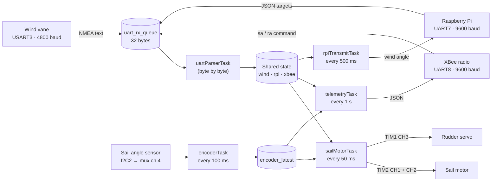

# How the Windbound Firmware Works

> A plain-English walkthrough of what the code on the boat's main board actually does.
> Short sections. Lots of bullets. Skip around: every section stands on its own.
>
> **Note:** describes `main` at commit `be75eba` (2026-09-15). If the code changed since, trust the code.

---

## TL;DR (read this, then decide what else you need)

- **The board:** an STM32H573 microcontroller running **FreeRTOS** (a tiny operating system that runs several "tasks" side by side).
- **It listens to 3 things:**
  - the **Raspberry Pi** (the autopilot brain): sends target sail + rudder angles
  - the **XBee radio** (a human on shore): can override the Pi
  - the **wind vane**: wind direction
- **It reads 1 sensor:** the **sail angle sensor** (AS5600 magnet encoder).
- **It drives 2 things:**
  - the **sail motor** (spins the mast)
  - the **rudder servo**
- **20 times a second** it decides: *who's in charge right now?* → *where should the sail and rudder be?* → *drive the motors.*
- **If nobody has talked to it recently, it parks:** sail motor off, rudder centered.
- **It reports back:** telemetry to the radio every 1 s, wind angle to the Pi every 0.5 s.

---

## Where to go in this doc

| If you want to… | Jump to |
|---|---|
| See the whole thing in one picture | [The big picture](#big-picture) |
| Follow one command from shore to rudder | [Life of a radio command](#radio-command) |
| Know what's wired to what | [What's plugged into the board](#hardware) |
| Understand the decision-making | [The control loop](#control-loop) |
| Know the exact message formats | [Message cheat sheet](#messages) |
| Know what happens when something dies | [When stuff breaks](#failures) |
| Avoid surprises | [Gotchas](#gotchas) |
| Change a number | ["I want to change…"](#recipes) |
| Build / flash / test | [Build, flash, test](#build) |

---

<a id="big-picture"></a>

## The big picture



**The pattern, in 3 bullets:**

- **Inputs write** to a shared "whiteboard" (latest wind, latest Pi packet, latest radio command, latest sail angle).
- **The control task reads** the whiteboard, decides, and drives the motors.
- **Nobody calls anybody directly.** Tasks only meet at the whiteboard. That's what keeps it simple.

---

<a id="radio-command"></a>

## Life of a radio command

Follow one command from someone on shore all the way to the rudder:

1. **Shore sends** `{sa:20,ra:-10}` + newline over the XBee.
   - `sa` = sail angle (°), `ra` = rudder angle (°)
2. **Each byte** lands on UART8 → a tiny interrupt pushes it into `uart_rx_queue`.
3. **`uartParserTask`** collects bytes from `{` until the newline.
4. **The parser** pulls out `sa = 20`, `ra = -10`.
5. **`Xbee_UpdateLatest`** stores it on the whiteboard **with a timestamp**.
6. **Within 50 ms**, the control task wakes up and sees a radio command that's **less than 2 s old** → radio is in charge.
7. **Sail:**
   - target sensor angle = 180 + 20 = **200°**
   - sensor says 180° → error = +20° (more than the 4° dead band)
   - → motor channel 2 runs at ~86% until the sail is within 4° of 200°
8. **Rudder:** pulse = 1370 + (−10 ÷ 45) × 400 ≈ **1281 µs** → servo turns.
9. **No new command for 2 s?** Radio goes "stale" → the Pi takes over, or everything parks.

---

<a id="hardware"></a>

## What's plugged into the board

**In one line:** 4 serial ports, 1 I2C bus, 2 PWM timers do all the real work.

| Thing | Talks over | Speed | Pins (RX / TX) | Code |
|---|---|---|---|---|
| Raspberry Pi | UART7 | 9600 baud | PE7 / PE8 | [app_comms.c](../User/Src/app_comms.c) |
| XBee radio | UART8 | 9600 baud | PE0 / PE2 | [app_comms.c](../User/Src/app_comms.c) |
| Wind vane | USART3 | 4800 baud | PD9 / PD8 | [app_comms.c](../User/Src/app_comms.c) |
| Debug USB serial | UART4 | 115200 baud | PD11 / PD12 | [board_io.c](../User/Src/board_io.c) |
| Sail angle sensor (AS5600) | I2C2 via TCA9548A mux, channel 4 | — | SCL PB10 / SDA PB11 | [encoder.c](../User/Src/encoder.c) |
| Sail (mast) motor | TIM2 CH1 + CH2 (PWM) | ~5 kHz | PA15 + PA1 | [boat_control.c](../User/Src/boat_control.c) |
| Rudder servo | TIM1 CH3 (PWM) | 50 Hz | PA10 | [boat_control.c](../User/Src/boat_control.c) |
| Heartbeat LED | GPIO | — | PA8 (`DEBUG_LED1`) | [system_tasks.c](../User/Src/system_tasks.c) |

- **Clock:** internal HSI oscillator → PLL → **64 MHz**. Every bus and timer runs at 64 MHz.
  - (The journal mentions the HSE crystal, but the generated code uses HSI only.)
- **I2C addresses:** mux = `0x70`, AS5600 = `0x36`.

<details>
<summary>Set up by CubeMX but <b>not used</b> by any app code yet (click)</summary>

- **USART1** (PB14/PB15): beacon
- **USART2** (PA3/PD5): XSENSE / GPS
- **UART5** (PB13/PD2) and **USART6** (PC6/PC7): BMS 1 and BMS 2
- **I2C1** (PB8/PB9)
- **OCTOSPI**: external flash chip
- **RTC**
- **TIM3** (PB4/PB5) and **TIM5** (PA0/PA2): flap motor PWM. Configured, but `PWM_Init` never starts them.
- **TIM4** and **TIM15**: input capture on the MPPT pins
- Only USART3, UART4, UART7, UART8 have interrupts turned on, so the others can't receive anything right now.

</details>

> **Tip:** The PCB has some wiring surprises (swapped wind vane TX/RX, reused motor outputs, reversed switch labels). See [Journal.md → Hardware Errata](Journal.md).

---

## Boot: from power-on to running

**In one line:** set up hardware → create tasks → hand control to FreeRTOS forever.

1. **`main()`** in [main.c](../Core/Src/main.c)
   - `HAL_Init()`: resets peripherals
   - `SystemClock_Config()`: 64 MHz
   - `MX_..._Init()`: GPIO, both I2Cs, all timers, all 8 UARTs, flash, RTC, cache
2. **`MX_FREERTOS_Init()`** in [app_freertos.c](../Core/Src/app_freertos.c) creates:
   - **5 mutexes** (locks): debug print, encoder, rpi, wind, xbee
   - **3 semaphores** (signals): I2C done, radio TX free, Pi TX free
   - **1 queue:** `uart_rx_queue`, 32 slots, each holds `{which port, one byte}`
   - **7 tasks** (next section)
3. **`osKernelStart()`**: the scheduler takes over. `main` never continues past this.
4. **`initTask` runs first** (it has the highest priority):
   - calls `PWM_Init()`: starts the rudder PWM and the 2 sail-motor PWM channels at 0
   - then **deletes itself**
5. **`uartParserTask` starts** and turns on receive interrupts for UART3, 4, 7, 8.
6. Everything else just starts looping.

---

## The tasks (who does what, how often)

**In one line:** 7 tasks; 1 runs once, 1 waits for bytes, the rest run on timers.

| Task name | Function | Runs | Job |
|---|---|---|---|
| `initTask` | `InitTask` | once | Start PWM, then exit |
| `uartParserTask` | `UARTParserTask` | when bytes arrive | Turn incoming bytes into whiteboard updates |
| `encoderTask` | `EncoderTask` | every 100 ms | Read sail angle sensor |
| `sailMotorTask` | `BoatControlTask` | every **50 ms** (20 Hz) | **The brain**: decide + drive sail and rudder |
| `telemetryTask` | `TelemetryTask` | every 1 s | Send status JSON to the radio |
| `rpiTransmitTask` | `RpiTransmitTask` | every 500 ms | Send wind angle to the Pi |
| `heartbeatTask` | `HeartbeatTask` | every 2 s | Blink LED for 1 ms ("I'm alive") |

<details>
<summary>Priorities and stack sizes (click)</summary>

| Task | Priority | Stack |
|---|---|---|
| `initTask` | High | 512 B |
| `uartParserTask` | Normal | 2 KB |
| `encoderTask` | Normal | 1 KB |
| `sailMotorTask` | Normal | 2 KB |
| `telemetryTask` | Normal | 2 KB |
| `rpiTransmitTask` | Normal | 512 B |
| `heartbeatTask` | Below normal | 512 B |

- FreeRTOS tick = **1 ms**. Total heap = 64 KB.
- Tasks with the same priority take turns.
- All of these are defined in CubeMX ([Nautono_V3.ioc](../Nautono_V3.ioc)) and generated into `app_freertos.c`.

</details>

> **Tip:** The control task's **name** is `sailMotorTask` but its **function** is `BoatControlTask`. Same thing, two names.

---

## Getting data in (the UART pipeline)

**In one line:** interrupt grabs 1 byte → queue → parser task builds a full message → parser → whiteboard.

### Step 1: the interrupt (super short on purpose)

- Every UART is set to receive **1 byte at a time**.
- When a byte arrives, `HAL_UART_RxCpltCallback` ([board_io.c](../User/Src/board_io.c)):
  - wraps it as `{port, byte}`
  - drops it into `uart_rx_queue` (**doesn't wait**; if the queue is full, the byte is lost)
  - re-arms the UART for the next byte
- **Debug port (UART4) only:** also echoes the byte back so you see what you type.

### Step 2: `uartParserTask` sorts bytes by port

| Port | Goes to | Starts on | Ends on | Max length |
|---|---|---|---|---|
| UART3 (wind) | `ProcessWindvaneData` | `$` | newline | 63 chars |
| UART8 (radio) | `ProcessXbeeData` | `{` | newline | 63 chars |
| UART7 (Pi) | `ProcessRaspberryData` | `{` | the matching `}` (counts braces) | 255 chars |
| UART4 (debug) | *ignored* | — | — | — |

- **Too long?** The message is thrown away and it waits for the next start character.
- **Wind vane only:** it checks the first 6 characters are exactly `$IIMWV` as they arrive. Any other NMEA sentence is dropped right away.

### Step 3: parse → whiteboard

- Parsers live in [app_protocol.c](../User/Src/app_protocol.c). They're **pure** (no hardware), which is why they can be unit tested.
- **Parse fails?** The packet is ignored. The old value stays on the whiteboard.
- **Parse succeeds?** Save it:
  - wind → `Wind_UpdateLatest`
  - radio → `Xbee_UpdateLatest` (also stamps **time received**)
  - Pi → `RPi_UpdateLatest` (also stamps **time received**)
- The Pi path prints `Got full string` and `RPi data parsed and stored` on the debug port.

---

<a id="messages"></a>

## Message cheat sheet

### Wind vane → board (NMEA 0183, USART3)

```text
$IIMWV,123.4,R,5.6,N,A*2F
```

- Fields: direction (°), reference (R = relative, T = true), speed, unit (K/M/N), status (A = valid, V = invalid)
- **Watch out:** the checksum (`*2F`) is **not** checked. Status `V` is **not** rejected.

### Radio → board (UART8)

```text
{sa:30.5,ra:-12.25}
```

- Must start with `{` and **end with a newline**.
- `sa` = sail angle, `ra` = rudder angle, in degrees. **Both are required.**
- **Watch out:** keys must be **unquoted** (`sa:`, not `"sa":`). The quoted form won't match.

### Pi → board (UART7)

```json
{"TargetsOutput":[{
  "targetBearing":91.5, "waypointLat":44.25, "waypointLon":-63.75,
  "targetSailAngle":25.5, "targetFlapAngle":3.0, "targetRudderAngle":-12.5,
  "latitude":44.6, "longitude":-63.6, "headingAngle":180.0, "windAngle":42.25
}]}
```

- **All 10 fields are required**, or the whole packet is ignored.
- The parser looks inside the first `[ { … } ]`. It doesn't check the `TargetsOutput` name.
- Only `targetSailAngle` and `targetRudderAngle` actually move anything. The rest is stored and forwarded in telemetry.

### Board → Pi (every 500 ms)

```json
{"SensorInput":[{"windAngle":123}]}
```

- Wind direction from the vane, as a whole number.

### Board → radio telemetry (every 1 s)

```text
{"tb":91,"tlat":44,"tlon":-63,"tsa":25,"tfa":3,"tra":-12,"clat":44,"clon":-63,"cb":180,"wa":42,"sa":181,}
```

| Key | Meaning | From |
|---|---|---|
| `tb` | target bearing | Pi |
| `tlat` / `tlon` | target waypoint | Pi |
| `tsa` / `tfa` / `tra` | target sail / flap / rudder angle | Pi |
| `clat` / `clon` | current position | Pi |
| `cb` | current heading | Pi |
| `wa` | wind angle | Pi |
| `sa` | **measured** sail angle | sail sensor |

- **Watch out: everything is a whole number**, so lat/lon lose their decimals (44.6 → 44).
- **Watch out:** there's a **trailing comma** before `}`. Strict JSON parsers will reject it. (The [simpleSailboatGUI](https://github.com/Dalhousie-Autonomous-Sailboat-Team/simpleSailboatGUI) monitor tolerates it.)
- **Watch out:** it shows the **Pi's** targets, not what the boat actually chose. To see who's in charge, watch the debug port.

---

## The whiteboard (shared state)

**In one line:** each data source has one "latest value" slot, protected by a lock.

- Lives in [app_state.c](../User/Src/app_state.c) (wind, radio, Pi) and [encoder.c](../User/Src/encoder.c) (sail angle).
- **Writing:** grab the lock → copy the whole struct in → release.
- **Reading:** grab the lock → copy the whole struct out → release.
- Nobody keeps a pointer to shared data. You always work on **your own copy**. No half-updated reads.
- **Freshness** = `last_updated_ms` + `ever_received`. Only the radio and Pi slots have these.

| Slot | Written by | Read by | Has a timestamp? |
|---|---|---|---|
| wind | uartParserTask | control (debug print only), rpiTransmitTask | No |
| xbee | uartParserTask | control | Yes |
| rpi | uartParserTask | control, telemetry | Yes |
| encoder | encoderTask | control, telemetry | No |

---

## Reading the sail angle

**In one line:** every 100 ms, pick mux channel 4, ask the AS5600 for its angle, store it.

- The sensor sits behind a **TCA9548A I2C multiplexer** (a switch that picks 1 of 8 I2C devices).
- Each loop in `EncoderTask` ([encoder.c](../User/Src/encoder.c)):
  1. Write `0x10` to the mux → select channel 4
  2. Write register `0x0E` to the AS5600 → "I want the angle"
  3. Read 2 bytes → 12-bit raw value (0–4095)
  4. Convert to degrees → stored as a **whole number 0–359**
  5. Save to the whiteboard, sleep 100 ms
- **How I2C waits without hogging the CPU** ([board_io.c](../User/Src/board_io.c)):
  - start the transfer in interrupt mode
  - sleep on `i2c2_semaphore`
  - the "done" (or "error") interrupt wakes the task back up
  - timeouts: 10 ms for the mux, 100 ms for the sensor

---

<a id="control-loop"></a>

## The control loop (the brain)

**In one line:** every 50 ms: snapshot everything → pick who's in charge → move sail (on/off) and rudder (direct).

### The loop ([boat_control.c](../User/Src/boat_control.c))

1. Copy the latest wind, Pi, radio, and sail angle off the whiteboard.
2. Hand them to `ControlLogic_Evaluate` ([control_logic.c](../User/Src/control_logic.c)).
   - This function is **pure math**: no hardware, no RTOS. Easy to test.
3. Every 10th loop (~every 0.5 s), print status to the debug port:
   - `Valid Xbee found` / `Valid Xbee not found`
   - `Valid RPi found` / `Valid RPi not found`
   - `wind=… rpi_sail=… rpi_rudder=… xbee_sail=… xbee_rudder=… enc=…`
4. Write the 3 PWM values to the timers.
5. Sleep 50 ms. Repeat.

### Step A: is each source fresh?

- **Radio fresh** = received at least once **and** less than **2 s** old
- **Pi fresh** = received at least once **and** less than **10 s** old
- (Both timeouts are ~2× how often each source is expected to send.)

### Step B: who's in charge?

Decided **separately** for sail and for rudder:

| Radio fresh? | Pi fresh? | Who wins |
|---|---|---|
| Yes | Yes | **Radio**, unless its value is exactly `0` → then **Pi** |
| Yes | No | Radio |
| No | Yes | Pi |
| No | No | Nobody → target is `0` |

- **Tip:** **Radio `0` means "no opinion, let the Pi decide."** That's how a human can override just the sail or just the rudder.
- **Tip:** There's a `boat_mode` constant (`MODE_AUTONOMOUS`) in `boat_control.c`, but **nothing reads it**. The table above is what actually happens.

### Step C: the sail (bang-bang control)

"Bang-bang" = the motor is either **on** or **off**. No gentle speeds.

- **Convert the command to a sensor angle:** `target = 180 + sail_angle`
  - so sail `0°` = sensor reads `180°`, sail `+45°` = sensor `225°`
  - `SAIL_CENTER_DEG` (180) is the calibration knob
- **Find the error:** `target − measured`, wrapped to −180…+180 (always the short way around)
- **Decide:**

| Error | Channel 1 | Channel 2 | Sail does |
|---|---|---|---|
| more than **+4°** | off | **~86%** | turns toward a higher angle |
| less than **−4°** | **~86%** | off | turns toward a lower angle |
| within ±4° | off | off | stops (close enough) |
| no fresh source | off | off | **stops, no matter what** |

- The 4° "close enough" zone is the **dead band**. It stops the motor from jittering back and forth.
- ~86% = `MOTOR_SLOW` (11000) out of the timer's max (12800).

### Step D: the rudder (direct control)

No feedback sensor: just send the servo a pulse width.

- `pulse (µs) = 1370 + (rudder_angle ÷ 45) × 400`
  - `1370` = standard servo center `1500` + trim `−130` (`RUDDER_ANGLE_OFFSET_PWM`)

| Rudder angle | Pulse |
|---|---|
| −45° | 970 µs |
| 0° | 1370 µs (center) |
| +45° | 1770 µs |

- No fresh source → angle `0` → rudder **centers**.

---

## Getting data out

**In one line:** radio and Pi sends are "fire and forget" with a lock so only one message goes out at a time.

- **`Radio_Send` / `RPi_Send`** ([board_io.c](../User/Src/board_io.c)):
  1. wait for that port's "TX free" semaphore
  2. start an interrupt-driven send (CPU is free while bytes go out)
  3. the "TX done" interrupt gives the semaphore back
- **`Debug_Print`**: the simple version. Sends byte by byte and **waits** until done. A mutex stops two tasks from mixing their text.

---

## Sleep and heartbeat

- **Heartbeat:** LED on PA8 flashes for **1 ms every 2 s**. Flashing = scheduler alive.
- **Sleep:** FreeRTOS "tickless idle" is on. When every task is waiting:
  - `PreSleepProcessing` pauses the HAL tick and puts the CPU to sleep (`WFI`)
  - any interrupt wakes it, then `PostSleepProcessing` resumes the tick
  - define `LED_SLEEP_INDICATOR` to light `DEBUG_LED2` + `GPIO4` while asleep (handy for measuring)
- Known issue (journal): it wakes up every ~200–250 ms even when nothing's happening.

---

<a id="failures"></a>

## When stuff breaks

| What fails | What the boat does |
|---|---|
| Radio quiet for 2 s | Radio ignored. Pi takes over (if fresh). |
| Pi quiet for 10 s, radio also quiet | **Sail motor off, rudder centered.** |
| Nothing received since power-on | Sail motor off, rudder centered. |
| Garbled packet | Ignored. Last good values stay until they time out. |
| Wind vane dies | Pi keeps getting the **last** wind angle forever (no timeout). |
| Sail sensor dies | **Danger:** control keeps using the **last** angle. If that's far from the target, **the motor keeps running**. |
| Too many bytes at once (queue full) | Extra bytes silently dropped → that packet fails to parse. |

---

<a id="gotchas"></a>

## Gotchas (read before you debug)

**Sail sensor**

- **The sail angle never goes stale.** There's no timestamp on it. A dead sensor = motor chasing a target it'll never "see" reached.
- **An I2C error can look like success.** The error interrupt wakes the task the same way "done" does, so a failed read can be stored as a real angle (probably 0°).
- **Sensor failure = instant retry.** If the mux or sensor read fails, `EncoderTask` loops again **without** the 100 ms sleep.

**Radio commands**

- **You can't command exactly 0° from the radio while the Pi is fresh.** 0 means "defer to the Pi".
- **Bad numbers become 0.** `StringToFloat` returns 0 for garbage → from the radio, that also means "defer to the Pi".

**Rudder**

- **Rudder angle isn't clamped.** If the Pi sends 90°, the servo gets a 2170 µs pulse. (`PWM_SetDutyCycle` clamps to 1000–2000 µs, but the control loop writes the timer directly and skips it.)
- **Odd startup pulse.** `PWM_Init` sets the rudder to `6400` (6.4 ms) even though the comment says 1500. The control loop overwrites it within 50 ms.

**Serial ports and telemetry**

- **Only the debug UART recovers from errors.** If UART3/7/8 hit a receive error (like an overrun), nothing re-arms them, so that port can stop listening until reset.
- **Telemetry rounds everything to whole numbers**, including lat/lon.

**Docs and comments**

- **README is out of date.** It talks about `L1`–`L4` folders and `usermain.c`. Those are gone; see the code map below.
- **Comments can lie.** e.g. heartbeat comment says 100 ms (it's 1 ms), motor comment says 20 kHz with 3200 max (TIM2 is ~5 kHz with 12800 max).

---

## Code map

**In one line:** `Core/` is generated by CubeMX, `User/` is hand-written. Edit `User/`.

### `User/` (hand-written; this is the firmware)

| File | Role | Think of it as… |
|---|---|---|
| [board_io.c](../User/Src/board_io.c) | UART + I2C drivers, interrupt callbacks, `Debug_Print` | the hands |
| [encoder.c](../User/Src/encoder.c) | Mux + AS5600 + `EncoderTask` | the sail's eye |
| [app_protocol.c](../User/Src/app_protocol.c) | Parsers: NMEA, radio, Pi JSON, `StringToFloat` | the translator |
| [app_comms.c](../User/Src/app_comms.c) | Byte framing, `uartParserTask`, telemetry, Pi transmit | the mailroom |
| [app_state.c](../User/Src/app_state.c) | Locked "latest value" slots | the whiteboard |
| [control_logic.c](../User/Src/control_logic.c) | Who's in charge + sail/rudder math (pure) | the brain |
| [boat_control.c](../User/Src/boat_control.c) | 20 Hz control task + PWM setup | the spinal cord |
| [system_tasks.c](../User/Src/system_tasks.c) | Init task, heartbeat, sleep hooks | the pulse |
| [pid.c](../User/Src/pid.c) | PID controller | unused (tested, ready) |
| [fw_assert.c](../User/Src/fw_assert.c) | `ASSERT` macro → saves message + debugger breakpoint | unused |
| [command_dispatch.c](../User/Src/command_dispatch.c) | Old debug-port command line | fully commented out |

### `Core/` (CubeMX-generated; edit only inside `USER CODE BEGIN/END`)

- [main.c](../Core/Src/main.c): boot + clock
- [app_freertos.c](../Core/Src/app_freertos.c): tasks, mutexes, semaphores, queue
- `tim.c`, `usart.c`, `i2c.c`, `gpio.c`: peripheral setup
- `stm32h5xx_it.c`: interrupt handlers

### Everything else

- `tests/`: host-computer unit tests with fake hardware
- `Docs/`: schematic, datasheets, [Journal.md](Journal.md) (hardware errata + history)
- `Nautono_V3.ioc`: the CubeMX project (pins, peripherals, tasks)

---

<a id="recipes"></a>

## "I want to change…"

| I want to… | Change this | In |
|---|---|---|
| Make the sail move faster/slower | `MOTOR_SLOW` (max 12800) | control_logic.c |
| Make the sail stop closer/further from target | `SAIL_DEAD_BAND_DEG` | control_logic.c |
| Recalibrate where sail "0°" is | `SAIL_CENTER_DEG` = sensor reading when centered | control_logic.c |
| Fix the sail moving the wrong way | Swap which channel gets `MOTOR_SLOW` (or swap motor wires) | control_logic.c |
| Trim the rudder center | `RUDDER_ANGLE_OFFSET_PWM` | control_logic.c |
| Change how long until radio/Pi go stale | `XBEE_TIMEOUT_MS` / `RPI_TIMEOUT_MS` | control_logic.c |
| Change the control loop speed | `SAIL_TASK_PERIOD_MS` | boat_control.c |
| Change telemetry rate | `TELEMETRY_PERIOD_MS` | app_comms.c |
| Add a telemetry field | the `snprintf` in `TelemetryTask` (and the GUI's `parsing.py`) | app_comms.c |
| Add a task / mutex / queue / peripheral | CubeMX → regenerate → write the function in `User/` | Nautono_V3.ioc |
| Add a new `.c` file | `target_sources` (and `tests/CMakeLists.txt` if tested) | CMakeLists.txt |

> **Tip:** Changed `control_logic.c`? Update [tests/test_control_logic.c](../tests/test_control_logic.c) **in the same commit**.

---

<a id="build"></a>

## Build, flash, test

### Build the firmware (macOS)

```sh
. tools/stm32-env.sh
cmake --preset Debug
cmake --build --preset Debug
```

- Output: `build/Debug/Nautono_V3.elf`
- Flash + debug: VS Code → Run and Debug → ST-LINK (needs a probe on the board).

### Run the host tests (no board needed)

```sh
cmake --preset Host-Tests
cmake --build --preset Host-Tests
ctest --preset Host-Tests
```

- Tests compile the `User/` modules on your computer with **fake** HAL/RTOS headers (`tests/fakes/`).
- **Current status at `be75eba`: 6 of 9 pass.**
  - `control_logic_tests` **fail**: they still expect the old full-speed motor value (12800) and a 1° dead band; the code now uses 11000 and 4°.
  - `app_state_tests` and `command_pipeline_tests` **don't build** on the host: `app_state.c` uses `NULL` without including `<stddef.h>`.
  - Tip: build with `cmake --build --preset Host-Tests -- -k` (or `--keep-going`) so one broken test doesn't stop the others.

---

## Mini glossary

- **FreeRTOS / RTOS**: tiny OS that lets several tasks share one CPU.
- **Task**: a loop that runs "at the same time" as other tasks.
- **Mutex**: a lock. Only one task can hold it, so shared data isn't read mid-update.
- **Semaphore**: a signal. "Wake up, your thing is done."
- **Queue**: a line of items one task drops in and another picks up.
- **Interrupt / ISR**: hardware poking the CPU ("a byte arrived!"). Must be very short.
- **UART**: simple 2-wire serial link (TX/RX). Baud = speed.
- **I2C**: 2-wire bus that talks to many chips by address.
- **Mux**: switch that picks which I2C device you're talking to.
- **PWM**: turning a pin on/off fast. Duty cycle = % of time on. Motors use it for power; servos read the **pulse width** as a position.
- **NMEA 0183**: plain-text format marine sensors use (`$IIMWV,...`).
- **Bang-bang control**: motor fully on or fully off; no in-between.
- **Dead band**: "close enough" zone where the controller does nothing.
- **Tick**: FreeRTOS's 1 ms clock.
