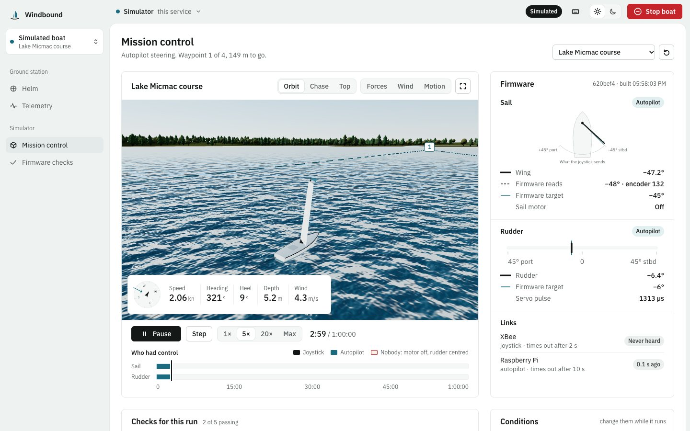

# Windbound simulator and ground station

Sail Windbound's real firmware in a simulated boat on Lake Micmac, steer it
the way the joystick does, and prove a firmware change works before it goes
anywhere near the water. Everything runs on your laptop and opens in your
browser.



## Start it

### 1. Install three things (once)

|                | macOS                                   | Windows                                                                                   | Linux                                      |
|----------------|-----------------------------------------|-------------------------------------------------------------------------------------------|--------------------------------------------|
| Python 3.11+   | `brew install python`                   | [python.org](https://www.python.org/downloads/) (tick **Add python.exe to PATH**)          | `sudo apt install python3 python3-venv`    |
| CMake          | `brew install cmake`                    | [cmake.org](https://cmake.org/download/) (tick **Add CMake to the PATH**)                  | `sudo apt install cmake`                   |
| A C compiler   | `xcode-select --install`                | [Build Tools for Visual Studio](https://visualstudio.microsoft.com/downloads/), with **Desktop development with C++** | `sudo apt install build-essential` |

You don't need the STM32 toolchain, the boat, or the joystick.

### 2. Run it

From the `windbound-firmware` folder:

```bash
python3 sim/start.py
```

On Windows, `py sim\start.py`. Or skip the terminal and double-click
**`sim/Start Windbound.command`** on a Mac, **`sim\Start Windbound.bat`** on
Windows.

Your browser opens Windbound at <http://127.0.0.1:8765>. The first start
takes a minute or two while it installs a few Python packages and compiles
the firmware; after that it starts in seconds. To stop it, press **Ctrl+C**
in the terminal (or close the window you double-clicked).

**The lake.** The depth map of Lake Micmac comes from the desktop ground
station repository, [simpleSailboatGUI](https://github.com/Dalhousie-Autonomous-Sailboat-Team/simpleSailboatGUI).
If that folder sits next to `windbound-firmware`, it's found on its own. If
not, the launcher says so and the boat sails on open water until you add it.

## A five-minute tour

1. **Watch it sail.** *Mission control* opens with the autopilot sailing the
   Lake Micmac course. Press **F** for full screen, **1 2 3** for the orbit,
   chase and top cameras, and drag to look around. Switch on **Forces** to
   see the lift, drag, keel, rudder and hull forces on the boat as arrows.
2. **See what the firmware sees.** The *Firmware* panel shows the wing's real
   angle against what the firmware reads from its encoder and the target it's
   driving to, the rudder and its servo pulse, and which link it's obeying.
   The timeline under the 3D view records who had control, second by second.
3. **Break something.** In *Conditions*, set **Autopilot sends every** to 5 s
   and watch the heading swing. Switch on **XBee silent** and **Autopilot
   silent**: within 10 s the firmware stops the sail motor and centres the
   rudder. **Sail encoder stops** shows what happens when the AS5600 dies.
4. **Take the helm.** Open *Helm*, choose **This laptop**, and steer with the
   sliders or **W A S D** (Shift for bigger steps, **X** to let go). Click
   the map to add waypoints, drag them to move them, and **Send route**.
5. **Change the firmware.** Edit `User/Src/control_logic.c`, then in
   *Firmware checks* press **Rebuild and reload**. Mission control is now
   sailing your code. **Run every check** proves it (see below).

Press **?** anywhere for the keyboard shortcuts.

## What's on screen

The sidebar has two groups. **Ground station** is the joystick's GUI;
**Simulator** is mission control for the simulated boat.

- **Helm**: the lake map with the route and the depth along each leg (the
  sandy water is shallower than the keel), the commands you're sending and
  what the boat does with them, and the links' health.
- **Telemetry**: every field the boat sends back, with what each one means,
  and the raw serial log you can filter, pause and download.
- **Mission control**: the boat in 3D, the run controls (pause, step, speed
  from real time to as fast as your computer goes), the firmware's view, this
  run's live checks, and the wind, autopilot rate and faults to test with.
- **Firmware checks**: which firmware is loaded, rebuild and reload, and the
  results of every test against it.

The sun and moon in the top bar switch between light (an afternoon on the
lake) and dark (just after sunset). **Stop boat** silences both links, the
only thing that makes the firmware stop the sail and centre the rudder.

## Change the firmware, then prove it

Edit anything under `User/`, then either:

- in **Firmware checks**, press **Rebuild and reload** (or switch on
  **Rebuild on save**). The simulator recompiles the firmware, loads the new
  build without restarting, and restarts the scenario on it. **Run every
  check** then runs the firmware's own unit tests and every simulator test
  against your code, and lists each result with the commit and the files
  you've changed;
- or run the same tests in a terminal:

```bash
sim/.venv/bin/python -m pytest sim       # Windows: sim\.venv\Scripts\python -m pytest sim
```

The tests rebuild the firmware first, so they always test the code as it is
now. They prove it three ways:

- **Properties** (`tests/test_invariants.py`): rules the control logic and
  protocol must keep for *every* input, each tried on thousands of random
  inputs: no fresh link means the motor is off and the rudder centred; the
  motor never drives both channels; it always turns the short way; commands
  parse back to what was sent.
- **Scenarios** (`tests/test_scenarios.py`): whole runs with the firmware in
  the loop: link loss, encoder failure, the operator taking over, beating to a
  waypoint, the Lake Micmac course without running aground.
- **Plumbing** (`test_firmware_binding.py`, `test_link.py`,
  `test_service.py`): the binding to the C code, the ground-station link and
  this web service.

A test marked `xfail(strict=True)` describes how the boat *should* behave and
fails today because of a known firmware problem; its reason says which. When
you fix the firmware, that test starts passing, pytest flags the XPASS, and
you remove the marker in the same change. GitHub runs all of this on every
push (`.github/workflows/host-tests.yml`).

## Use it with the real boat

- **This page with the real controller.** Click the connection button at the
  top (it says *Simulator*) and pick the controller's COM port, or type any
  serial URL. Helm and Telemetry then show the real boat; Mission control
  keeps running the simulator.
- **The desktop ground station with the simulator.** While Windbound runs,
  it also speaks the joystick controller's serial protocol on
  `socket://127.0.0.1:5760`. In the desktop ground station, pick **Simulator —
  socket://127.0.0.1:5760** from the COM port list and click **Connect**.

## If something goes wrong

- **"CMake isn't installed" or the firmware won't build**: install the three
  things above. On Windows, open a *new* terminal after installing so the
  PATH changes take effect.
- **The 3D view says it couldn't load**: it loads three.js and the fonts from
  the internet the first time you open it; after that the browser has them.
- **Port 8765 is busy**: the launcher picks the next free port and prints it.
  If Windbound is already running, it just opens that one.
- **No lake, just open water**: put
  [simpleSailboatGUI](https://github.com/Dalhousie-Autonomous-Sailboat-Team/simpleSailboatGUI)
  next to `windbound-firmware`, or set `WINDBOUND_LAKE_DIR` to its
  `lake_depth_maps` folder, and start again.
- **Start from scratch**: delete `sim/.venv` and `build/Host-Tests`; the next
  start rebuilds both.

## Under the hood

The simulator runs the real firmware logic (`User/Src/control_logic.c`,
`app_protocol.c`, `app_state.c`), compiled for your computer as a library,
against a physics model of the boat. The firmware's control logic, parsers
and telemetry formatting run in the loop; its UART byte framing, encoder I2C
driver and RTOS timing do not yet.

### From the command line

`start.py` is a thin wrapper. Inside `sim/`, with the environment active, the
same tools are available directly:

```bash
.venv/bin/python -m windbound_sim serve                   # the web app (start.py runs this)
.venv/bin/python -m windbound_sim serve --scenario beam-reach --speed 1
.venv/bin/python -m windbound_sim list                    # the scenarios
.venv/bin/python -m windbound_sim run beam-reach          # one run, headless, with a summary
.venv/bin/python -m windbound_sim run sail-step --set sail_drive.speed_dps_at_slow=120
```

`serve` takes `--scenario`, `--speed 1|5|20|max`, `--port`, `--link-port`
(`0` turns the desktop link off), `--model path/to/boat.glb`, `--no-open`
and `--set table.key=value` for any boat parameter. Headless runs go as fast
as the computer allows (an hour of sailing takes a few seconds). `run
<scenario> --link --speed 5` serves the desktop ground station without the
web app.

The default boat is drawn from `params/windbound.toml`. To show the real
boat, see `models/README.md`.

### What's in here

| File | What it does |
|------|--------------|
| `start.py`, `Start Windbound.*` | The launcher: sets up `.venv`, builds the firmware library, starts the web app. |
| `params/windbound.toml` | Every boat number in one place. Values marked PLACEHOLDER are estimates; replace them with measurements. |
| `windbound_sim/firmware.py` | ctypes binding to the firmware library; checks struct layouts against the C build. |
| `windbound_sim/sim.py` | The clock: runs each piece at the firmware's real task periods. |
| `windbound_sim/dynamics.py` | 3-DOF hull with heel, and the wing, keel and rudder as foils that stall. |
| `windbound_sim/actuators.py` | Sail gearmotor (from TIM2 duty) and rudder servo (from TIM1 pulse). |
| `windbound_sim/sensors.py` | AS5600 encoder, `$IIMWV` windvane, GPS and compass. |
| `windbound_sim/world.py` | Wind with gusts and shifts, lat/lon, lake depth grids. |
| `windbound_sim/autopilot.py` | Stand-in for the Raspberry Pi autopilot, speaking its UART7 protocol. |
| `windbound_sim/link.py` | TCP stand-in for the joystick controller's serial port. |
| `windbound_sim/service.py` | The web app's local server and its API. |
| `windbound_sim/runner.py` | Runs the simulation in real time for the page, with its timeline and live checks. |
| `windbound_sim/groundstation.py` | The ground station's view: parses the controller's lines from the simulator or a serial port. |
| `windbound_sim/proof.py` | Rebuilds and reloads the firmware library and runs the checks for the page. |
| `windbound_sim/scenarios.py` | Named scenarios used by the web app, the command line and the tests. |
| `windbound_sim/web/` | The page: Helm, Telemetry, Mission control (three.js) and Firmware checks. |
| `models/` | Where a `boat.glb` of the real boat goes, and how to make one. |
| `sil/sil_runtime.c` | Gives the firmware library a simulator-owned clock. |

Conventions: positions are metres north/east of the scenario origin; headings
and wind directions are degrees clockwise from north (wind is where it blows
from). Sail angle is positive with the trailing edge to port; rudder angle is
positive turning to starboard. Each is converted to firmware units at its port.

Not modelled yet: aerodynamic load on the sail motor, the wing flap, and the
windvane's own lag. Heel is modelled about one axis, with a righting arm from
`hull.gm_m`.
